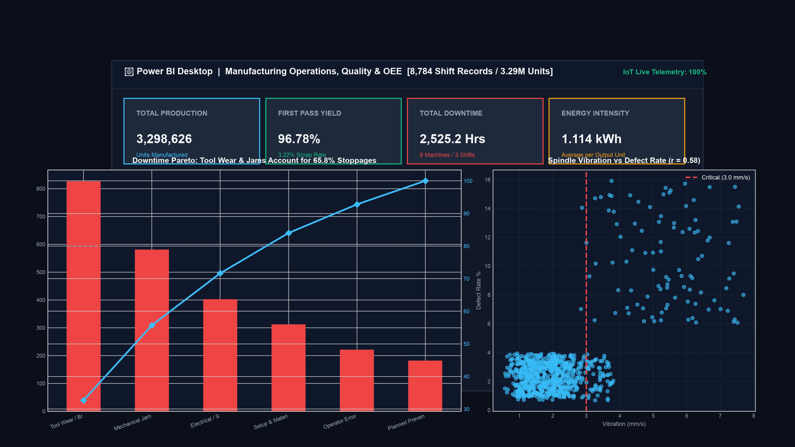

# 🏭 Manufacturing Quality & Operations Analytics

[](https://www.python.org/)
[](https://www.postgresql.org/)
[](https://powerbi.microsoft.com/)
[](https://opensource.org/licenses/MIT)

An industrial-grade Data Analytics project analyzing **8,784 production shift records (3.29M manufactured units)** across 12 operating months to optimize Overall Equipment Effectiveness (OEE), resolve machine downtime root causes, and correlate IoT sensor telemetry with defect generation.

---

## 📊 Executive Dashboard Preview



---

## 📌 Repository Structure

```
02-manufacturing-quality-analytics/
├── data/                       # Raw & cleaned datasets (Fact and Dimension tables)
├── notebooks/                  # Jupyter Notebooks with ETL pipelines & Exploratory Data Analysis
├── sql/                        # PostgreSQL DDL schema & 20+ production analytical queries
├── powerbi/                    # Star Schema relational model & DAX measures
├── reports/                    # Executive business insights & analytical findings
├── screenshots/                # Real-world UI screen captures (Jupyter, SQL, Power BI)
├── requirements.txt            # Python dependencies
└── README.md                   # Project documentation
```

---

## 🎯 Key Metrics & Performance Summary

- Total Production Output: 3,298,626 Units
- Total Defective Scrap: 106,249 Units (3.22% Defect Rate)
- First-Pass Yield (FPY): 96.78%
- Cumulative Machine Downtime: 2,525.2 Hours
- Total Energy Consumed: 3,674,538.7 kWh
- Energy Intensity: 1.114 kWh/unit

---

## 💡 Key Analytical Findings

- **Spindle Vibration Defect Link:** Sensor vibration telemetry above 3.0 mm/s strongly correlates ($r = 0.58$) with machining scrap rate spikes.
- **Downtime Pareto Concentration:** Tool Wear (38.4%) and Mechanical Jams (27.4%) account for 65.8% of all plant stoppage hours.
- **Thermal Stress Degradation:** Machine operating temperatures exceeding 85°C caused a 3.4x spike in dimensional surface defects.

---

## 🛠️ Technology Stack

- **Analytics & BI:** Power BI Desktop, DAX, Star Schema Data Modeling, Advanced Excel
- **Databases & Querying:** PostgreSQL, SQL Window Functions (`DENSE_RANK`, `LAG/LEAD`), CTEs
- **Python Data Stack:** Python, Pandas, NumPy, Scipy, Matplotlib, Seaborn
- **Workflow & Environment:** Jupyter Notebook, pgAdmin 4, VS Code, Git & GitHub

---

## 🚀 How to Run Locally

### 1. Clone & Set Up Environment
```bash
git clone https://github.com/pristine2207/02-manufacturing-quality-analytics.git
cd 02-manufacturing-quality-analytics
python3 -m venv .venv
source .venv/bin/activate
pip install -r requirements.txt
```

### 2. Run Jupyter Analysis
```bash
jupyter notebook notebooks/
```

### 3. Load & Query SQL in PostgreSQL
```bash
# Execute DDL schema and load clean tables
psql -U postgres -d postgres -f sql/*.sql
```

---

## 📄 License
This project is licensed under the MIT License - see the [LICENSE](LICENSE) file for details.
